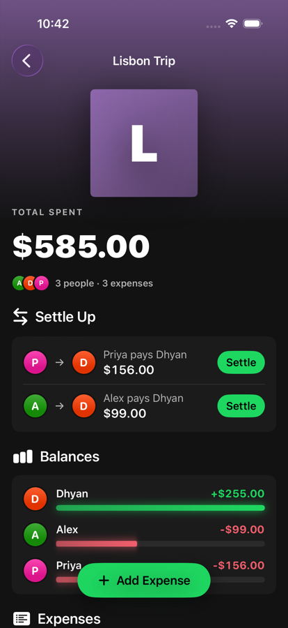
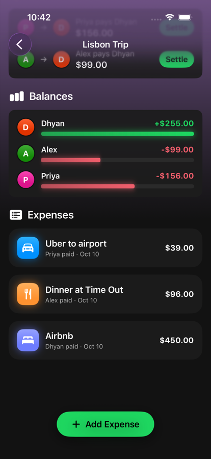
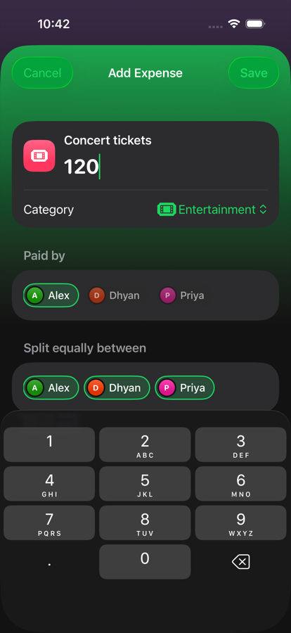
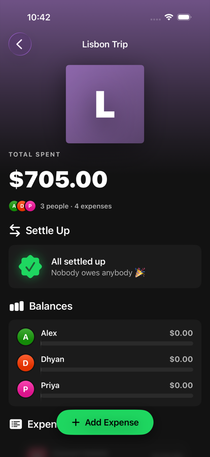

# SettleUp — Native iOS Expense Splitting App

A native iOS expense-splitting app built with **SwiftUI**, **MVVM + Combine**,
**Core Data + CloudKit sync**, and an on-device **CoreML** classifier for
automatic expense categorization. The core algorithmic piece is a
**debt-simplification (min-transaction graph reduction)** engine that
collapses a group's tangled IOUs down to the smallest set of payments needed
to settle up.

<p align="center">
  
  
  
  
  
</p>

## Highlights

| | |
|---|---|
| **75.4% fewer payments** | 26,217 → 6,438 transfers across 1,000 simulated groups |
| **100% correct** | 1,000 / 1,000 groups zeroed to the cent; 10,000 / 10,000 splits exact |
| **~53 ms** | Settlement plan for 50 members × 5,000 expenses |
| **13 / 13 tests passing** | Unit, randomized benchmark, and end-to-end UI tests |
| **~2,000 lines of Swift** | App + tests, zero third-party dependencies |

## Features

- **Groups & members**: create groups, add members, long-press to delete.
- **Expenses**: equal splits among any subset of members, exact to the cent
  (leftover cents are distributed so splits always sum to the total).
- **Live auto-categorization**: the category icon updates as you type the title
  (keyword heuristic today; CoreML model slot ready).
- **Settle up**: minimal payment plan; recorded payments are persisted and
  offset balances, so settled debts never reappear.
- **Offline-first sync**: Core Data is the source of truth, with CloudKit
  mirroring via `NSPersistentCloudKitContainer`.
- **Spotify-inspired UI**: near-black theme, green accent, playlist-style
  header that picks up the group's color.
- **Motion**: shimmer skeleton on load, staggered entrances, scroll-driven
  reveal (scale/tilt/blur), zoom transition into a group, spring-animated
  balance bars, rolling numbers, confetti and haptics on settle.

## Why this exists

Splitting expenses in a group (a trip, a shared apartment, a dinner) quickly
produces a web of who-owes-whom. Rather than showing every individual debt,
this app nets everyone's balance and computes the minimal set of payments
that zeroes the group out — the same problem LeetCode calls "Optimal Account
Balancing."

## Architecture

```
SplitWiseClone/
├── App/                  App entry point, environment wiring
├── Models/                Plain Swift domain types (Group, Member, Expense, Settlement)
├── ViewModels/            ObservableObject classes — Combine-driven state
├── Views/                 SwiftUI views
├── Persistence/           Core Data + CloudKit stack
├── ML/                    On-device CoreML expense categorizer
├── Algorithms/            DebtSimplifier — the min-transaction reduction engine
└── Extensions/            Theme (palette, avatars) and Effects (animations)

SplitWiseCloneTests/       XCTest unit + benchmark tests (algorithm, categorizer)
SplitWiseCloneUITests/     End-to-end UI test (create → add expense → settle)
```

**Pattern:** MVVM. Views are declarative SwiftUI and hold no business logic;
`ObservableObject` ViewModels own state and expose it via `@Published`
properties; Combine pipelines react to Core Data's remote-change
notifications so the UI updates automatically when CloudKit sync brings in
changes from another device.

Core Data entities are prefixed `CD` (`CDGroup`, `CDMember`, `CDExpense`,
`CDExpenseSplit`, `CDSettlement`) to avoid colliding with the plain Swift
domain structs of the same name in `Models/DomainModels.swift`.

## Core Data + CloudKit

Persistence uses `NSPersistentCloudKitContainer`. The local SQLite store is
always the source of truth — every read/write hits it first — so the app is
fully usable offline. CloudKit sync catches up in the background whenever
connectivity returns. The `.xcdatamodeld` is checked in at
`SplitWiseClone/Persistence/SplitWiseClone.xcdatamodeld`.

Known typo to be aware of: `CDExpenseSplit`'s amount field is named
`ownedAmount` (not `owedAmount`) in the schema — code that reads/writes it
uses the field as spelled.

## On-device ML

`ExpenseCategorizer` wraps a CoreML text classifier trained with Apple
CreateML on a small labeled dataset of expense titles → categories. Inference
runs fully on-device; no expense data is ever sent to an external API. Until
the trained `.mlmodel` is dropped into `ML/`, it falls back to a keyword
heuristic so the rest of the app builds and runs. See the TODO in
`ExpenseCategorizer.swift` for the CreateML training steps.

## Debt simplification

`Algorithms/DebtSimplifier.swift` nets every member's balance per currency,
then greedily matches the largest creditor against the largest debtor until
all balances are zero. Multi-currency debts are **never** netted against each
other (that would require a live FX rate). Covered by
`DebtSimplifierTests.swift`, including rounding-to-cents and multi-currency
isolation cases.

## Requirements

- Xcode 26+ (Xcode 27 runs simulators in **DeviceHub**, which replaced Simulator.app)
- iOS 26.5 deployment target (uses `NavigationStack` zoom transitions,
  `scrollTransition`, `phaseAnimator`, `symbolEffect`, `sensoryFeedback`)
- An Apple Developer account with iCloud/CloudKit capability enabled if you
  want to test sync (not required to build/run locally)

## Setup

1. Clone the repo and open `SplitWiseClone.xcodeproj` in Xcode.
2. Select an iOS Simulator as the run destination (not "My Mac" — several
   view modifiers are iOS-only).
3. Build and run. The app works fully offline even before CloudKit
   entitlements are configured — sync just won't do anything until they are.
4. Optional: add `-demoData` under *Edit Scheme → Run → Arguments* to launch
   with a seeded "Lisbon Trip" group in an in-memory store.

## Testing

```bash
xcodebuild test \
  -scheme SplitWiseClone \
  -destination 'platform=iOS Simulator,name=iPhone 17 Pro'
```

Or `Cmd+U` in Xcode. 13 tests across three suites:

- `DebtSimplifierTests`: core reduction logic, rounding to cents, an
  already-settled group, multi-currency isolation.
- `DebtSimplifierBenchmarkTests`: seeded randomized simulations (see
  [Benchmarks](#benchmarks)).
- `ExpenseCategorizerTests` and `SplitWiseCloneUITests`: the UI test drives the
  full flow (create group → add expense → settle → "All settled up").

## Status / TODOs

- [x] `.xcdatamodeld` created; `GroupListViewModel`/`GroupDetailViewModel`
      wired to real `NSFetchRequest`s and saves.
- [x] Create group, add expense, compute balances/settlements, mark settled
      all persist to Core Data.
- [x] `CDSettlement.date` records when a payment was made.
- [x] Recorded payments are folded into the ledger, so settled debts don't
      reappear after new expenses are added.
- [x] UI tests (end-to-end create → add → settle flow).
- [x] App icon, animated Spotify-style UI.
- [x] Delete groups and expenses (cascade deletes in the model).
- [ ] Train and drop in the CreateML expense-category `.mlmodel`.
- [ ] Custom (non-equal) split entry in `AddExpenseView`.
- [ ] Login / auth — not started, no user model exists yet.
- [ ] Launch screen.
- [ ] Settlement history view.

## License

MIT

## Benchmarks

Measured by `SplitWiseCloneTests/DebtSimplifierBenchmarkTests.swift`
(seeded, reproducible; iPhone 17 Pro simulator, iOS 26.5):

| Metric | Result |
|---|---|
| Random groups simulated (3–12 members, 5–60 expenses) | 1,000 |
| Max payments in any plan | ≤ n − 1 for every group (asserted) |
| Payments needed: pairwise-netted vs. simplified | 26,217 → 6,438 (**75.4% fewer**) |
| Avg payments per group | 26.2 → 6.4 |
| Groups fully zeroed after applying the plan | 1,000 / 1,000 (0¢ residual) |
| Equal splits summing exactly to the cent | 10,000 / 10,000 |
| 50 members × 5,000 expenses simplify time | ~53–58 ms median (varies by run) |

Run them with `xcodebuild test -scheme SplitWiseClone -destination 'platform=iOS Simulator,name=iPhone 17 Pro'`;
results print as `METRIC …` lines in the test log.
