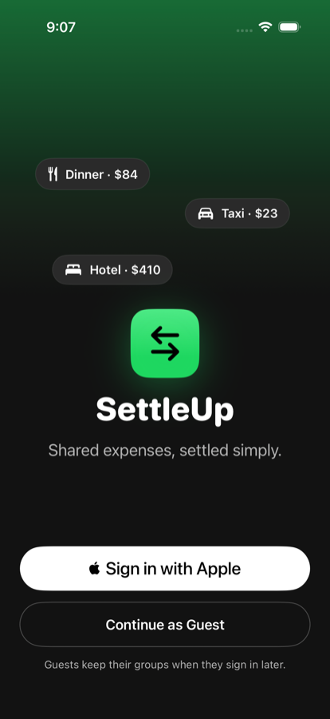
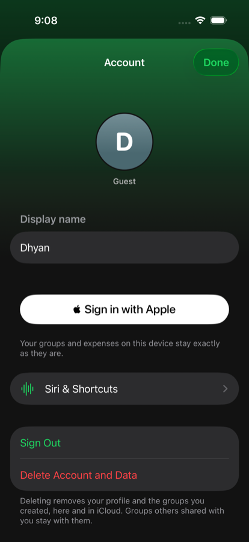
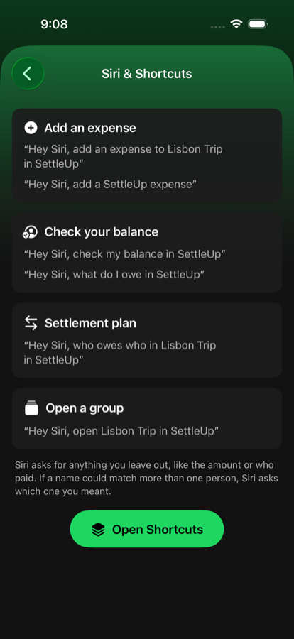

# SettleUp — Native iOS Expense Splitting App

A native iOS app for tracking shared expenses and settling group balances,
built with **SwiftUI**, **MVVM + Combine**, **Core Data + CloudKit** (sync and
group sharing), **Sign in with Apple**, and **App Intents** so you can add
expenses by talking to Siri, without opening the app.

> "Hey Siri, add an expense to Lisbon Trip in SettleUp."

The core algorithmic piece is a **debt-simplification (min-transaction graph
reduction)** engine that collapses a group's tangled IOUs down to the
smallest set of payments needed to settle up.

<p align="center">
  
  
  
  
</p>
<p align="center">
  
  
  
  
</p>

## Highlights

| | |
|---|---|
| **Hands-free entry** | Add expenses, check balances, and hear settlement plans through Siri |
| **75.4% fewer payments** | 26,217 → 6,438 transfers across 1,000 simulated groups |
| **Exact to the cent** | 1,000 / 1,000 groups zeroed; 10,000 / 10,000 splits exact; mismatched splits are rejected |
| **~48 ms** | Settlement plan for 50 members × 5,000 expenses |
| **35 / 35 tests passing** | Unit, Siri intent, randomized benchmark, and end-to-end UI tests |
| **~4,400 lines of Swift** | App + tests, zero third-party dependencies |

## Features

- **Sign in with Apple or continue as a guest.** No email/password form. After
  signing in you pick a display name and optional photo. Guests keep all their
  groups when they sign in later.
- **Account screen**: edit your profile, sign out, or delete your account and data.
- **Groups & members**: create groups (you're added automatically), add people,
  and tell SettleUp which member is you in older or shared groups.
- **Expenses**: split equally or by custom amounts, in any currency, with a date.
  Tap an expense to edit it. Leftover cents are assigned so equal splits always
  sum to the total, and custom splits that don't add up can't be saved.
- **Your balance everywhere**: "you owe" / "you're owed" on every group and an
  overall total on the groups screen.
- **Settle up**: minimal payment plan; recorded payments offset balances, so
  settled debts never reappear.
- **Group sharing**: invite other iCloud users to a group through the system
  sharing sheet (CloudKit shares). Signing in and sharing are separate: Sign in
  with Apple identifies you to SettleUp, CloudKit sharing lets people collaborate.
- **Offline-first sync**: Core Data is the source of truth, mirrored to CloudKit
  via `NSPersistentCloudKitContainer`.
- **Live auto-categorization**: the category icon updates as you type the title.
- **Calm, smooth UI**: dark theme with a single green accent and muted colors;
  light spring animations (staggered entrances, zoom into a group, rolling
  numbers, animated balance bars, confetti and haptics on settle) tuned to keep
  scrolling at full frame rate.

## Siri

SettleUp has **no microphone button**. You start with "Hey Siri"; Siri handles
the voice interaction and passes the request to the app's App Intents.

| Action | Try saying |
|---|---|
| Add an expense | "Add an expense to Lisbon Trip in SettleUp", "Add a SettleUp expense" |
| Check my balance | "Check my balance in SettleUp", "What do I owe in SettleUp" |
| Settlement plan | "Who owes who in Lisbon Trip in SettleUp" |
| Open a group | "Open Lisbon Trip in SettleUp" |

How the add-expense flow works:

1. Siri resolves the group (spoken group names are registered with Siri) and
   asks for anything missing: amount, what it was for, who paid.
2. People are matched against that group only. If a name could be two people
   ("Maya" vs "Maya Patel"), Siri asks which one; "me" means your linked member.
3. The amount, currency, payer, and participants are validated, then the split
   is computed with the **same `DebtSimplifier` code the form uses**.
4. If you didn't name anyone, Siri confirms "split equally between everyone?"
   before saving instead of assuming.
5. For custom amounts, Siri opens SettleUp with the expense pre-filled for review.
6. Siri confirms: *"Added Dinner to Lisbon Trip for $84.00, split equally
   between you, Maya, and Ravi."*

App Shortcut phrases can only contain one spoken parameter (the group), so the
other details are collected as Siri follow-up questions rather than parsed
from a single long sentence.

## Architecture

```
SplitWiseClone/
├── App/                  Entry point, root onboarding switch, router, scene delegate (share acceptance)
├── Account/              AccountStore: Sign in with Apple, guest mode, profile
├── Models/               Domain types (Group, Member, Expense, Settlement) and ExpenseValidator
├── ViewModels/           ObservableObject classes — Combine-driven state
├── Views/                SwiftUI screens (Account/ holds welcome, profile, account, Siri help)
├── Intents/              App Intents, App Entities, and App Shortcuts for Siri
├── Persistence/          Core Data + CloudKit stack, ExpenseRepository (the single write path)
├── ML/                   On-device expense categorizer
├── Algorithms/           DebtSimplifier — the min-transaction reduction engine
└── Extensions/           Theme (palette, avatars) and Effects (animations)

SplitWiseCloneTests/      Unit, Siri intent, and benchmark tests
SplitWiseCloneUITests/    End-to-end UI tests (onboarding → group → expenses → settle → account)
```

**Pattern:** MVVM. Views are declarative SwiftUI and hold no business logic;
ViewModels own state and expose it via `@Published`; Combine pipelines react
to Core Data saves and CloudKit remote-change notifications.

**One write path.** `ExpenseRepository` is used by both the ViewModels and the
App Intents. It validates every expense with `ExpenseValidator` (positive
amount, at most two decimals, known ISO currency, payer and participants in
the group, splits summing exactly to the total) before saving, so an expense
dictated to Siri is stored exactly like one typed into the form.

**Who is "me".** Each member has an optional `userID`. Whoever creates a group
is linked automatically; in other groups you pick yourself once. The link
syncs with the group, so each collaborator in a shared group sees their own
balance.

Core Data entities are prefixed `CD` (`CDGroup`, `CDMember`, `CDExpense`,
`CDExpenseSplit`, `CDSettlement`) to avoid colliding with the plain Swift
domain structs in `Models/DomainModels.swift`.

## Core Data + CloudKit

`PersistenceController` uses `NSPersistentCloudKitContainer` with two stores:

- **Private** (the original store file, so existing data survives upgrades):
  your own groups, mirrored to your private CloudKit database.
- **Shared**: groups other iCloud users shared with you.

New expenses are always inserted into the same store as their group, since
Core Data can't relate objects across stores. The local SQLite store is the
source of truth, so the app is fully usable offline and sync catches up later.

Known typo to be aware of: `CDExpenseSplit`'s amount field is named
`ownedAmount` (not `owedAmount`) in the schema.

## Accounts and privacy

Sign in with Apple gives SettleUp a stable user identifier; the app never sees
or stores an Apple password. Only the identifier, display name, optional email,
and optional profile photo are kept on the device. Deleting your account
removes your profile and the groups you created (locally and, through sync,
in iCloud); groups other people shared with you stay with them. Revoking the
Apple token on deletion needs a server and isn't implemented.

## On-device ML

`ExpenseCategorizer` wraps a CoreML text classifier slot. Inference runs fully
on-device. Until a trained `.mlmodel` is dropped into `ML/`, it falls back to
a keyword heuristic. See the TODO in `ExpenseCategorizer.swift` for the
CreateML training steps.

## Debt simplification

`Algorithms/DebtSimplifier.swift` nets every member's balance per currency,
then greedily matches the largest creditor against the largest debtor until
all balances are zero. Multi-currency debts are **never** netted against each
other (that would require a live FX rate).

## Requirements

- Xcode 26+ (Xcode 27 runs simulators in **DeviceHub**, which replaced Simulator.app)
- iOS 26.5 deployment target
- An Apple Developer account for Sign in with Apple, iCloud sync, and sharing
  (not needed to build, run as a guest, and run the tests)

## Setup

1. Clone the repo and open `SplitWiseClone.xcodeproj` in Xcode.
2. Select an iOS Simulator as the run destination (not "My Mac").
3. Build and run. Choose **Continue as Guest** to use the app with no account
   setup; everything works offline.
4. For Sign in with Apple, iCloud sync, and group sharing, open
   *Signing & Capabilities* for the `SplitWiseClone` target with your team
   selected and make sure these are enabled (they're declared in
   `SplitWiseClone/SplitWiseClone.entitlements`):
   - Sign in with Apple
   - iCloud → CloudKit, container `iCloud.com.dhyan.SplitWiseClone`
     (change it in `PersistenceController.cloudKitContainerID` if you use your own)
   - Push Notifications and Background Modes → Remote notifications (for sync)
5. Sharing and Siri voice requests need real devices signed in to iCloud;
   group sharing needs two different iCloud accounts.
6. Optional: add `-demoData` under *Edit Scheme → Run → Arguments* to launch
   with a seeded "Lisbon Trip" group in an in-memory store.

## Testing

```bash
xcodebuild test \
  -scheme SplitWiseClone \
  -destination 'platform=iOS Simulator,name=iPhone 17 Pro' \
  -parallel-testing-enabled NO
```

Or `Cmd+U` in Xcode. Tests always run against an in-memory store and
throwaway account storage, never your real data. 35 tests across these suites:

- `DebtSimplifierTests`: reduction logic, rounding to cents, already-settled
  groups, multi-currency isolation.
- `DebtSimplifierBenchmarkTests`: seeded randomized simulations (see
  [Benchmarks](#benchmarks)).
- `ExpenseRepositoryTests`: exact-cent validation, rejected bad amounts,
  currencies and strangers, editing, recorded payments, "me" linking,
  guest → Apple relinking, account deletion.
- `SiriIntentTests`: runs the App Intents directly — "$84 dinner split between
  me, Maya and Ravi", leftover cents, explicit payer, invalid amounts, people
  from other groups, asking who paid instead of guessing, ambiguous names,
  balance/settlement-plan/open-group intents.
- `NameMatcherTests`, `ExpenseCategorizerTests`.
- `SplitWiseCloneUITests`: the full journey (welcome → guest → profile → create
  group → equal expense → custom split that doesn't add up is caught → edit →
  settle → account → Siri help), plus sign-out and the sign-in options. The
  journey test attaches the screenshots used in this README.

## Status / TODOs

- [x] Create groups, add/edit/delete expenses, balances, settlement plan,
      recorded payments; all persisted to Core Data.
- [x] Custom (non-equal) splits, currency and date on expenses.
- [x] Sign in with Apple, guest mode, profile setup, account screen
      (edit, sign out, delete account and data).
- [x] CloudKit private + shared stores; invite people to a group.
- [x] Siri: add expense, check balance, settlement plan, open group.
- [x] Unit, Siri intent, and end-to-end UI tests.
- [ ] Verify sharing and Siri voice flows on physical devices.
- [ ] Revoke the Sign in with Apple token on account deletion (needs a server).
- [ ] Train and drop in the CreateML expense-category `.mlmodel`.
- [ ] Re-enable CI (`.github/workflows-disabled/`) on a runner with Xcode 26+.
- [ ] Settlement history view.

## License

MIT

## Benchmarks

Measured by `SplitWiseCloneTests/DebtSimplifierBenchmarkTests.swift`
(seeded, reproducible; iPhone 17 Pro simulator, iOS 26.5):

| Metric | Result |
|---|---|
| Random groups simulated (3–12 members, 5–60 expenses) | 1,000 |
| Max payments in any plan | ≤ n − 1 for every group (asserted) |
| Payments needed: pairwise-netted vs. simplified | 26,217 → 6,438 (**75.4% fewer**) |
| Avg payments per group | 26.2 → 6.4 |
| Groups fully zeroed after applying the plan | 1,000 / 1,000 (0¢ residual) |
| Equal splits summing exactly to the cent | 10,000 / 10,000 |
| 50 members × 5,000 expenses simplify time | ~48–58 ms median (varies by run) |

Results print as `METRIC …` lines in the test log.
